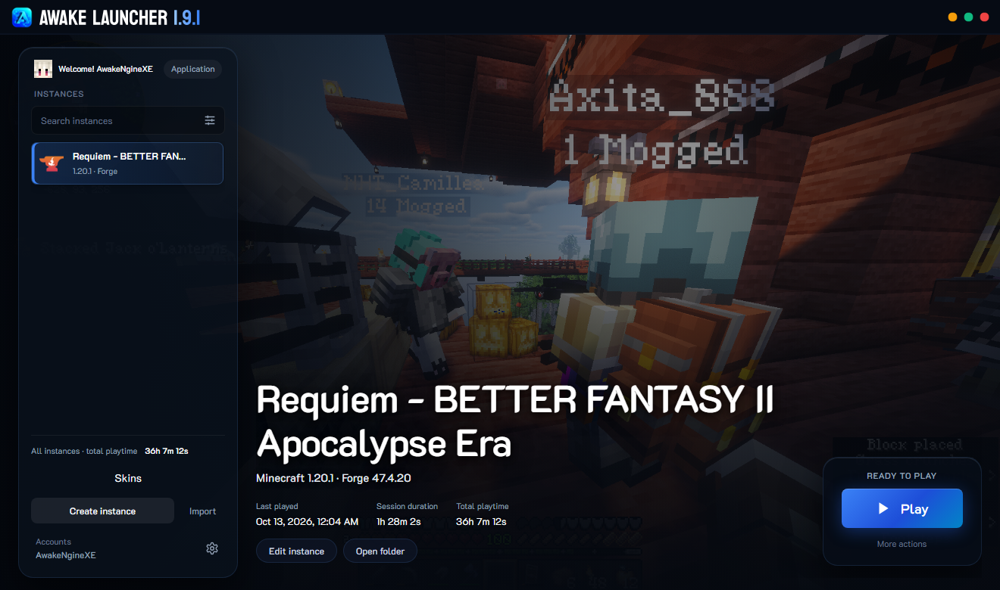

# Awake Launcher

Awake Launcher is a modern desktop launcher for Minecraft: Java Edition. It combines a sleek glassmorphic interface with Prism Launcher's robust C++ and Qt core, providing independent instance isolation, comprehensive mod and pack management, and fine-grained performance tuning.

[Download for Windows x64](https://github.com/awakenginexe/Awake-Launcher/releases/latest) · [Build from source](BUILDING.md) · [Report a bug](https://github.com/awakenginexe/Awake-Launcher/issues)

 

## Features

### Modern Glass Interface & Performance
- **Glassmorphic UI:** Smooth, dark glass styling built with Vue 3 embedded via Qt WebEngine.
- **Hardware-Friendly Compositor:** Hardware overlay-safe software rendering using Microsoft WARP D3D11 to deliver fluid 60 FPS transitions without triggering NVIDIA overlay hooks.
- **Dynamic Artwork:** Automatic instance background artwork with fallback to bundled Minecraft wallpaper.
- **Accessibility & Customization:** Reduced motion toggle, compact library rows, and option to close the launcher upon game launch to free system resources.

### Instance & Modpack Management
- **Full Instance Isolation:** Keep vanilla, Forge, NeoForge, Fabric, and Quilt installations completely independent.
- **Integrated Modpack Catalog:** Browse and install packs directly from CurseForge, Modrinth, FTB, Technic, and ATLauncher.
- **One-Click Local Migration:** Import existing instances directly from CurseForge, ATLauncher, FTB App, Prism Launcher, MultiMC, or custom folders while preserving your original files.
- **Online Modpack Linking:** Link imported instances to their online modpack releases (CurseForge, Modrinth, ATLauncher) to receive update alerts, version reminders, and smooth in-place upgrades.

### Integrated Mod Browser
- **In-App Search:** Search and install mods directly from CurseForge and Modrinth without leaving the launcher.
- **Automatic Compatibility:** Filters compatible releases based on your instance's Minecraft version and mod loader.
- **Download Queue & Dependency Solver:** Review dependencies before installation, track download progress, and resume or retry after partial failures.

### Instance Editor & Live Tools
- **Tabbed Management:** Easily manage Mods, Resource Packs, Shader Packs, Worlds, Screenshots, Notes, and Version components.
- **Live Minecraft Console:** Real-time console log viewer with text search, line wrapping, one-click copying, and historical logs.
- **Safety Locks:** Instance settings are protected against modifications while the game is running to prevent data corruption.

### Java & Memory Tuning
- **Separated Java & Memory Controls:** Independent tabs for Java runtimes and memory allocations, configurable globally or per instance.
- **JVM Performance Presets:** Choose from **Compatible**, **Balanced**, **Performance**, or **Custom** presets with preserved custom JVM arguments.
- **Color-Coded Memory Presets:** Quick RAM allocation buttons (up to 30 GB) with safety indicators (**Safe**, **Caution**, **Danger**) based on your installed system RAM.
- **Hardware Privacy:** Streamer-friendly eye toggles to mask installed RAM and GPU details on screen.
- **GPU Selection:** Built-in chooser for dual-GPU laptops to assign Minecraft to dedicated high-performance graphics.

### Playtime & Statistics Tracking
- **Session & Lifetime Playtime:** Track last played timestamps, session durations, and total playtime for each instance.
- **Library Playtime Total:** View aggregated playtime across all your instances right in the launcher footer.

### 3D Skin & Cape Studio
- **Interactive 3D Viewer:** Full 3D skin model preview with mouse rotation, zoom, and arrow key controls.
- **Local Skin Library:** Save and manage multiple skin appearances locally with support for Classic and Slim models.
- **Player Skin Lookup:** Search public Minecraft usernames to preview and apply skins directly to your Microsoft account.
- **Layer & Cape Controls:** Individual toggles for skin layers (Hat, Jacket, Sleeves, Pants legs) and cape previews with accurate physics depth.

### Localization
- **Multi-Language Support:** Fully translated interface available in:
  - English (`en`)
  - Thai (`th` - ภาษาไทย)
  - Simplified Chinese (`zh-CN` - 简体中文)
  - Traditional Chinese (`zh-TW` - 繁體中文)

## Installation

### Installer (Recommended)
Download **Setup.exe** from the [latest release](https://github.com/awakenginexe/Awake-Launcher/releases/latest) for a per-user installation with a Start Menu shortcut and uninstaller.
- Accounts and instances are stored separately and preserved when updating or uninstalling.
- Make sure to close Awake Launcher before installing updates.

### Portable
Download the **Windows x64 ZIP** and extract it into any writable folder, then launch `awakelauncher.exe`.
- Keep all files together in the folder and back up your data before replacing files.
- Release packages include the required Microsoft C++ runtime and SHA-256 checksums.

### Storage Options
During setup, you can select one of three data storage modes:
- **Normal:** `%APPDATA%\AwakeLauncher` (default)
- **Compact:** `AwakeLauncherData` located inside the installation folder
- **Custom:** Any folder of your choice

> [!NOTE]
> Updates preserve your storage location. Changing location later does not move existing accounts or instances automatically; copy your data or select the existing folder while the launcher is closed.

## Getting Started

### Accounts & Instances
1. Open **Accounts** to add your Microsoft account.
2. Select **Create instance** to install a vanilla Minecraft version or download a modpack.

### Migrating from Other Launchers
To import an existing pack from another launcher, navigate to **Create instance → Local import**. You can auto-detect common locations or browse directly to a custom folder:
- **CurseForge:** Select the Minecraft modding folder or a pack containing `minecraftinstance.json` (*Settings → Minecraft → Minecraft Modding Folder → Open*).
- **ATLauncher / FTB App:** Select an installed pack containing `instance.json`.
- **Prism Launcher / MultiMC:** Select an instance folder containing `instance.cfg` and `mmc-pack.json` (select the parent of `.minecraft` or `minecraft`).

> [!IMPORTANT]
> Close Minecraft before importing. Awake copies the instance and keeps your original installation intact.

### Linking Modpack Updates
For imported packs that need ongoing updates, open **Edit instance → Versions → Link installed modpack**:
1. Select the publishing source (**CurseForge**, **Modrinth**, or **ATLauncher**).
2. Locate the matching modpack and choose your currently installed release.

Linking loads release metadata so Awake can perform version checks and update reminders without reinstalling game files.

## Updates

- **Automatic Checks:** Awake checks for stable updates daily and on application startup.
- **Manual Checks:** Go to **Application → Check for updates** or check **Settings → About**.
- **In-App Updater:** Installed Windows builds provide **Update now**, which downloads and verifies Setup, closes the launcher, installs in-place, and restarts with all accounts and instances intact.
- **Portable Builds:** Downloads an updated ZIP via your browser to extract over your installation folder.

> [!CAUTION]
> Always close Minecraft before applying launcher updates.

## Privacy & Telemetry

- **Minimal Startup Telemetry:** Release builds send a single anonymous `app_started` event to PostHog EU at startup containing only `app_version` and `os` (`$process_person_profile: false`).
- **No Personal Data:** Awake does not detect country or transmit account information, hardware IDs, file paths, instances, mod lists, or logs. A random session ID is generated in memory and never persisted.
- **Fail-Safe:** Telemetry requests are asynchronous, non-retried, and have no impact on launcher functionality or UI.
- **Source Builds:** Telemetry is disabled when `POSTHOG_PROJECT_TOKEN` is left empty.

## Development & Compatibility

- **Platforms:** Windows x64 is the primary build and validation target. Linux and macOS support are under validation.
- **Minimum Resolution:** The minimum window size is **1320×780**.
- **Microsoft Application ID:** Approved on October 5, 2026 for the Minecraft API allow list. Official builds include the application ID through GitHub Actions secrets. Source builds and forks must supply their own approved application ID. No Microsoft client secret or password is embedded.

## Help & Contributions

- **Bug Reports:** When opening an issue on GitHub, include your Awake Launcher version, OS, reproduction steps, and sanitized logs (with account details removed).
- **Contributing:** Review [CONTRIBUTING.md](CONTRIBUTING.md) and our [CODE_OF_CONDUCT.md](CODE_OF_CONDUCT.md) before submitting pull requests.

## License

- **Code:** Licensed under [GNU GPL version 3 only](LICENSE).
- **Third-Party Notices:** See [COPYING.md](COPYING.md) for full upstream and third-party copyright notices.
- **Branding & Assets:** The logo and artwork in `program_info/` are licensed under [CC BY-SA 4.0](program_info/LICENSE).
- **Translations:** Bundled translations in `launcher/awake/translations/` are licensed under [Apache-2.0](launcher/awake/translations/LICENSE).

Awake Launcher is independent of Prism Launcher, Mojang, and Microsoft.
